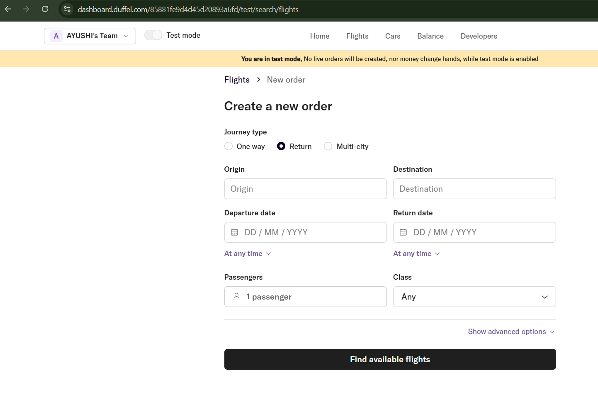
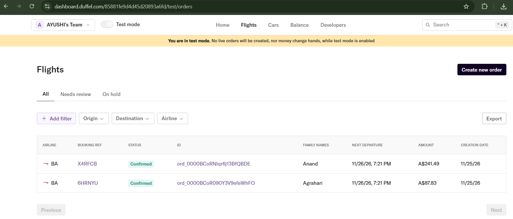

# ✈️ Flight Booking AI Agent

A CLI-based **Flight Booking Assistant** built with **LangChain** and a local LLM (**Qwen 2.5 3B** via Ollama). It integrates with the **Duffel Flights API (`v2`)** for live flight search and booking, falls back to local JSON storage if the API fails, and enforces a **Human-in-the-Loop (HITL)** terminal `yes/no` confirmation gate before booking.

## 🚀 Setup & Run

1. **Prerequisites:** Python 3.10+ and [Ollama](https://ollama.com) running locally with `qwen2.5:3b`:
   ```bash
   ollama pull qwen2.5:3b
   ```

2. **Create & activate virtual environment:**
   ```bash
   python -m venv .venv
   .venv\Scripts\Activate.ps1      # Windows
   # source .venv/bin/activate     # macOS/Linux
   ```

3. **Install dependencies:**
   ```bash
   pip install langchain-ollama langchain-core requests python-dotenv
   ```

4. **Add `.env` file in the root folder:**
   ```env
   DUFFEL_ACCESS_TOKEN=duffel_test_your_token_here
   ```

5. **Run the agent:**
   ```bash
   python agent.py
   ```
   * **Search:** `Search economy flights from LHR to JFK on 2026-12-15`
   * **Book:** `Book offer off_... for Ayushi Agrahari, age 25` (type `yes` or `no` at the confirmation prompt)
   * **Exit:** Type `exit` or `quit`

## 🌐 What is Duffel & Why Use It?

**Duffel** is a modern Flights API platform (`v2`) for searching airlines, pricing offers, and creating orders.

* **Why use it:** Provides a realistic `OfferRequest` $\rightarrow$ `Offer` $\rightarrow$ `Order` workflow with a free **Test Mode** (`duffel_test_...`) and sandbox carrier (**Duffel Airways**) so bookings can be tested safely without real charges.

### How to Log In & Connect Duffel

1. Sign in at [app.duffel.com](https://app.duffel.com) and switch **Test mode** **ON** in the top bar.
2. Go to **Developers → Access tokens → Create access token** (select **Read & write**).
3. Copy the `duffel_test_...` token into your `.env` file as `DUFFEL_ACCESS_TOKEN`.

### Checking Simulated Routes & Booked Flights in Duffel Dashboard

* **Search Simulated Routes & Available Flights:** Navigate to **Flights → Create new order**, enter the **Origin**, **Destination**, and **Departure date**, and click **Find available flights** to view all available simulated offers for that route and date.
  

* **View Booked Flights:** Navigate to **Flights** (Orders tab) in the top menu to inspect all confirmed bookings, including airline, booking reference (`PNR`), order ID (`ord_...`), passenger family name, departure time, and fare amount.
  

## 📂 Project Files

* **`agent.py`** — Runs the `ChatOllama` conversation loop (`MAX_STEPS = 6`) and enforces the terminal `yes/no` confirmation gate before `book_flight` runs.
* **`tools.py`** — Implements `search_flights` and `book_flight` using Duffel API `v2` (with retry on `502`/`503`/`504`), in-memory `OFFER_CACHE`, and fallback to local JSON when Duffel fails.
* **`data/flights.json`** — Local fallback flight inventory used when Duffel search is unavailable.
* **`data/bookings.json`** — Stores fallback booking records when local fallback mode is triggered.
* **`.env`** — Holds `DUFFEL_ACCESS_TOKEN` securely outside version control.